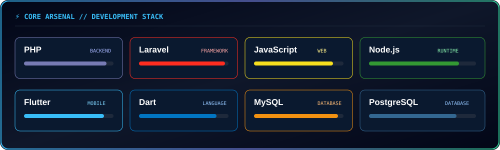

<div align="center">

<!-- ========================= -->
<!-- CYBER ANIMATED BANNER -->
<!-- ========================= -->


<br><br>

<!-- ========================= -->
<!-- TYPING ANIMATION -->
<!-- ========================= -->

<a href="https://github.com/lelekrecing">


</a>

<br><br>

<!-- ========================= -->
<!-- ACTION BADGES -->
<!-- ========================= -->

<p>

<a href="https://github.com/lelekrecing?tab=repositories">

</a>

<a href="mailto:emailkamu@gmail.com">

</a>

<a href="https://instagram.com/usernamekamu">

</a>


</p>

</div>

<br>

<!-- ========================= -->
<!-- NEON DIVIDER -->
<!-- ========================= -->


<br>

<!-- ========================= -->
<!-- DEVELOPER COMMAND CENTER -->
<!-- ========================= -->

## 🧑‍🚀 Developer Command Center

<table>
<tr>

<td width="62%" valign="top">

<table>

<tr>
<td>🚀 <b>Current Mission</b></td>
<td>Developing <b>Si-Merah-Koja</b> & <b>Monitoring PLN</b></td>
</tr>

<tr>
<td>🌐 <b>Web Stack</b></td>
<td>
<code>PHP</code> •
<code>Laravel</code> •
<code>JavaScript</code> •
<code>Node.js</code>
</td>
</tr>

<tr>
<td>📱 <b>Mobile Stack</b></td>
<td>
<code>Flutter</code> •
<code>Dart</code>
</td>
</tr>

<tr>
<td>🗄️ <b>Databases</b></td>
<td>
<code>MySQL</code> •
<code>PostgreSQL</code>
</td>
</tr>

<tr>
<td>🛠️ <b>Environment</b></td>
<td>
Laragon • VS Code • Git • GitHub • Postman
</td>
</tr>

<tr>
<td>⚡ <b>Development Style</b></td>
<td>
Clean Code • REST API • CRUD • MVC • Responsive UI
</td>
</tr>

</table>

</td>

<td width="38%" align="center">


</td>

</tr>
</table>

<br>

<!-- ========================= -->
<!-- TECH STACK -->
<!-- ========================= -->

## ⚡ Tech Stack & Engineering Arsenal

<div align="center">


<br><br>


<br><br>


</div>

<br>

<!-- ========================= -->
<!-- TECH BADGES -->
<!-- ========================= -->

<div align="center">


<br>


<br>


<br>


<br>


</div>

<br>

<!-- ========================= -->
<!-- ANIMATED TECH PANEL -->
<!-- ========================= -->

<div align="center">



</div>

<br>

<!-- ========================= -->
<!-- FEATURED PROJECTS -->
<!-- ========================= -->

## 🔥 Featured Systems & Repositories

| Project | Technology | Status |
| :--- | :--- | :--- |
| **[Si-Merah-Koja](https://github.com/lelekrecing/simerahkoja)** | `Laravel` `PHP` `MySQL` | 🟢 Active Development |
| **[Monitoring PLN](https://github.com/lelekrecing/monitoring_pln)** | `Laravel` `Blade` `MySQL` | 🟢 Production System |
| **[Aplikasi Pengaduan Masyarakat](https://github.com/lelekrecing/Aplikasi-Pengaduan-Masyarakat)** | `PHP` `Laravel` `MySQL` | 🟢 Completed |
| **[Sistem Pendukung Keputusan](https://github.com/lelekrecing/spk)** | `Laravel` `Blade` `MySQL` | 🟢 Completed |

<br>

<!-- ========================= -->
<!-- PROJECT CARDS -->
<!-- ========================= -->

<div align="center">

<a href="https://github.com/lelekrecing/simerahkoja">

</a>

<a href="https://github.com/lelekrecing/monitoring_pln">

</a>

</div>

<br>

<!-- ========================= -->
<!-- GITHUB STATS -->
<!-- ========================= -->

## 📊 GitHub Analytics

<div align="center">


</div>

<br>

<!-- ========================= -->
<!-- STREAK -->
<!-- ========================= -->

<div align="center">


</div>

<br>

<!-- ========================= -->
<!-- ACTIVITY GRAPH -->
<!-- ========================= -->

<div align="center">


</div>

<br>

<!-- ========================= -->
<!-- TROPHIES -->
<!-- ========================= -->

<div align="center">


</div>

<br>

<!-- ========================= -->
<!-- DEVELOPER TERMINAL -->
<!-- ========================= -->

## 🖥️ Developer Terminal

```bash
$ whoami

LELEKRECING

$ role

Fullstack Web & Mobile Developer

$ stack

PHP
Laravel
JavaScript
Node.js
Flutter
Dart
MySQL
PostgreSQL

$ philosophy

BUILD > TEST > DEBUG > DEPLOY > REPEAT

$ status

████████████████████████████████ 100%

SYSTEM ONLINE...
